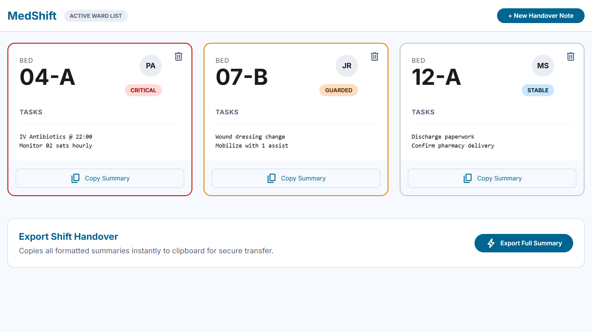
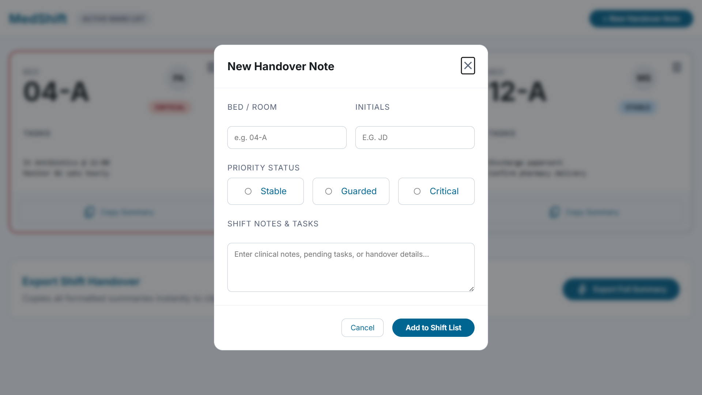

<h1 align="center">MedShift</h1>

<!-- TABLE OF CONTENTS -->

## Table of Contents

- [Table of Contents](#table-of-contents)
- [Overview](#overview)
  - [Built With](#built-with)
- [Features](#features)
- [How To Use](#how-to-use)
- [Acknowledgements](#acknowledgements)
- [Contact](#contact)

<!-- OVERVIEW -->

## Overview





MedShift is a lightweight, localized client-side clinical tool engineered to eliminate communication breakdowns during hospital shift turnovers. Developed as a capstone project, this application directly targets the cognitive fatigue experienced by healthcare workers completing demanding 6/12-hour shifts. It bridges the operational gap between heavy, lagging Electronic Medical Record (EMR) systems and informal messaging channels by optimizing rapid data entry and secure local persistence.

- **Live Demo Link:** You can access the live application hosted on Netlify here: [https://dzara-medshift.netlify.app](https://dzara-medshift.netlify.app)
- **Development Experience:** Building MedShift provided a rigorous, deep dive into user-centric healthcare design and structural engineering under rigid tech constraints. Prioritizing accessibility for an exhausted user persona reshaped how I approach cognitive friction, text contrast, and UI performance.
- **Key Learnings:** I mastered the application of standard browser APIs, deeply improving my understanding of native DOM manipulation, asynchronous operations with the Clipboard API, and robust data persistence using browser local storage state cycles.
- **Engineering Wisdom:** Technical simplicity delivers structural stability. In high-pressure, infrastructure-constrained clinical environments, zero-dependency vanilla architectures outperform bloated modern frameworks by guaranteeing speed, offline reliability, and instant utility.

### Built With

<!-- This section should list any major frameworks that you built your project using. Here are a few examples.-->

- [HTML](https://www.w3schools.com/html/) - Structural markup semantic layer.
- [CSS](https://www.w3schools.com/css/) - Responsive layout design system (Flexbox & Grid).
- [JavaScript](https://developer.mozilla.org/en-US/docs/Web/JavaScript) - Pure Vanilla core functional logic.

## Features

<!-- List the features of your application or follow the template. Don't share the figma file here :) -->

**Navbar** - Minimalist application head bar

- Contains the central platform branding title and sub-title.
- Features a sticky, high-contrast primary trigger button to launch the modal entry form.

**Main Section** - Dynamic clinical tracking patient queue

- Lists the active ward patient cards inside an interactive grid layout.
- Adapts seamlessly across hardware: renders in a multi-column grid on desktop screens (nursing stations) and drops smoothly into a stacked vertical list on mobile devices (smartphones).
- Includes dynamic client-side conditional logic that flags high-risk patients with custom border-color tags.
- Features individual data control triggers allowing users to clear patients from active tracking rows.

## How To Use

<!-- Example: -->

To clone and run this application, you'll need [Git](https://git-scm.com) and any text editor. [VSCode](https://code.visualstudio.com/) is highly recommended. Head over to the links above to download them for your operating system.

```bash
# Clone this repository
\$ git clone git@github.com:aminudzara/medshift.git

# Change directory into your project
\$ cd medshift

# Open with vscode from your terminal
\$ code .
```

To run the application locally, simply open the `index.html` file directly in any modern desktop or mobile web browser, or use the VSCode "Live Server" extension for real-time hot reloading.

## Acknowledgements

<!-- This section should list any articles or add-ons/plugins that helps you to complete the project. This is optional but it will help you in the future. For example: -->

- [Netlify Static Site Deployment Guide](https://www.netlify.com/blog/2016/10/27/a-step-by-step-guide-deploying-a-static-site-or-single-page-app/) - Used to configure single-page static hosting rules.
- [eHA Academy Capstone Project Guide](https://github.com/Abba-F-Daniel1/eHA-academy-captone-project-guide/blob/9b2cb88edbd715d68ccecd236695f12eaa503cad/README.md) - Referenced for portfolio structural benchmarks and submission parameters.
- [FreeCodeCamp LocalStorage Implementation Guide](https://www.freecodecamp.org/news/use-local-storage-in-modern-applications/) - Used to build state caching for zero data loss upon browser refresh.
- [FreeCodeCamp Async Clipboard API Tutorial](https://www.freecodecamp.org/news/copy-text-to-clipboard-javascript/) - Utilized to program the one-click plain text bulk transfer functionality.

## Contact

- LinkedIn: [Aminu Ahmadu Dzara](https://www.linkedin.com/in/aminu-dzara/)
- GitHub: [@aminudzara](https://github.com/aminudzara)
